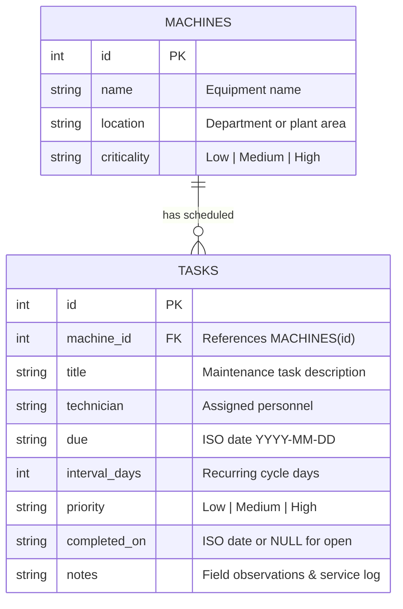

# Smart Factory Maintenance Platform (Vercel Edition)

A modern, high-performance preventive maintenance scheduler engineered with a **clean Python backend (FastAPI, SQLite WAL, Pydantic v2)** and a **Vercel Geist-inspired user interface**. Designed for industrial plant managers and technicians to record machinery, track recurring servicing schedules, prevent equipment downtime, and maintain an immutable service audit trail.

---

## ✨ Highlights & Vercel Design Inspiration

- **Geist Design Aesthetic:** Sleek monochromatic surfaces, deep blacks (`#000000`), subtle hairline borders (`#27272a`), and Geist-style sans-serif and mono typography.
- **Dark & Light Mode:** Seamless mode switching with persistent theme memory (`localStorage`).
- **Real-Time Operational KPIs:** Immediate visibility into total machinery, active work cycles, overdue alerts, due-today schedules, and plant completion reliability scores.
- **Pulsing Status Badges:** Visual urgency feedback with animated glowing status indicators (Overdue, Due Today, Due Soon, Scheduled).
- **Fast Search & Keyboard Shortcuts:** Instant multi-field filtering (`Cmd/Ctrl + K` or `/` focus search, `Esc` to dismiss dialogs).
- **Atomic Recurring Maintenance:** Completing any maintenance task automatically updates history with technician notes and schedules the subsequent cycle (`completion_date + interval_days`) in an isolated database transaction.
- **One-Click Windows Launcher:** Zero-configuration setup via `start_windows.bat`.
- **Zero-Build Web UI:** Single clean single-page app served directly by FastAPI without needing `npm` or Node.js.

---

## 🛠 Tech Stack

| Layer | Technology | Purpose |
|---|---|---|
| **Backend Framework** | **FastAPI** (Python 3.10+) | High-performance asynchronous REST API with auto-generated OpenAPI documentation. |
| **Data Validation** | **Pydantic v2** | Strict schema validation, type safety, and automatic serialization. |
| **Database Engine** | **SQLite 3 with WAL Mode** | High-concurrency relational persistence with foreign keys and ACID transactions. |
| **Frontend UI** | **Tailwind CSS + Geist Theme** | Lightweight, utility-first Vercel design system with responsive layouts. |
| **Icons & Micro-interactions** | **Lucide Icons** | Crisp, minimalist vector iconography. |
| **Testing** | **Python `unittest` & `TestClient`** | Automated test suite covering calculations, boundaries, database rules, and endpoints. |

---

## 🚀 Quickstart Guide

### 1. Requirements
- Python 3.10, 3.11, 3.12, 3.13, or 3.14.

### 2. Windows 1-Click Launch
Double-click `start_windows.bat`. The script automatically verifies Python, installs any missing packages from `requirements.txt`, boots the server, and opens your default browser.

### 3. Manual Terminal Launch

1. Clone or extract the repository into your desired directory.
2. Install dependencies:
   ```bash
   pip install -r requirements.txt
   ```
3. Run the application:
   ```bash
   python main.py
   ```
4. Access the web dashboard in your browser:
   - **Dashboard UI:** [http://127.0.0.1:8000](http://127.0.0.1:8000)
   - **Interactive API Docs (Swagger UI):** [http://127.0.0.1:8000/docs](http://127.0.0.1:8000/docs)
   - **Alternative ReDoc:** [http://127.0.0.1:8000/redoc](http://127.0.0.1:8000/redoc)

### CLI Flags

| Flag | Default | Description |
|---|---|---|
| `--host` | `127.0.0.1` | Network interface to bind. |
| `--port` | `8000` | Port to listen on. |
| `--no-browser` | `False` | Start the server without automatically launching the browser. |
| `--seed` | `False` | Pre-seed demo factory equipment and schedules on initial startup. |

---

## 🏗 Architecture & Data Flow

```text
┌────────────────────────────────────────────────────────┐
│             Vercel Geist-Inspired Web UI               │
│  (Tailwind CSS • Dark/Light Mode • Realtime KPI Cards) │
└───────────────────────────┬────────────────────────────┘
                            │ HTTP JSON / REST API
┌───────────────────────────▼────────────────────────────┐
│                    FastAPI Layer                       │
│    (Pydantic Validation • Route Handlers • CORS)       │
└───────────────────────────┬────────────────────────────┘
                            │ Python API / Engine
┌───────────────────────────▼────────────────────────────┐
│          Preventive Maintenance Core Engine            │
│  (Urgency Calculator • Status Boundaries • Recurrence) │
└───────────────────────────┬────────────────────────────┘
                            │ Parameterized SQL Transactions
┌───────────────────────────▼────────────────────────────┐
│              SQLite 3 Storage (factory.db)             │
│   (WAL Mode • Foreign Keys • Cascading Relational DB)  │
└────────────────────────────────────────────────────────┘
```

---

## 📋 Database Schema



### Relational Integrity:
- **Foreign Key Enforcement:** `PRAGMA foreign_keys = ON;`
- **Cascading Deletes:** Deleting equipment removes its associated maintenance schedule automatically.
- **WAL Journaling:** `PRAGMA journal_mode = WAL;` enables concurrent reads while writing.

---

## ⏱ Scheduling & Urgency Rules

Urgency is calculated relative to the local reference calendar date (`today`):

| Due Date Condition | Urgency Status | UI Tag Style |
|---|---|---|
| `due < today` | **Overdue** | Rose badge with pulsing red beacon (`pulse-dot`) |
| `due == today` | **Due today** | Amber badge with caution dot |
| `1 <= (due - today) <= 7` | **Due soon** | Sky blue badge with calendar indicator |
| `(due - today) > 7` | **Scheduled** | Emerald badge |

### Sorting Hierarchy
Open tasks are ordered deterministically:
1. Primary: Earliest `due` date first.
2. Secondary: `High` priority $\to$ `Medium` priority $\to$ `Low` priority.
3. Tertiary: Unique Task `id`.

### Recurrence Calculation
$$\text{Next Due Date} = \text{Actual Completion Date} + \text{Interval Days}$$
This deliberate design prevents calendar drift when maintenance is executed ahead of or behind schedule.

---

## 🧪 Test Suite

Run the automated test suite with standard Python `unittest`:

```bash
python -m unittest -v test_scheduler.py
```

### Coverage:
- **Status Boundaries:** Validates Overdue, Due Today, Due Soon (days 1 and 7), and Scheduled (day 8+).
- **Date Parsing:** Strict rejection of malformed dates (`2026-02-30`, `27/10/2026`, noncanonical strings).
- **Validation Constraints:** Non-empty titles, technicians, positive integer intervals.
- **Foreign Key Constraints:** Prevents orphan tasks referencing non-existent machinery.
- **Atomic Recurring Completion:** Verifies service log creation and automatic next-cycle calculation in a single transaction.
- **Double-Completion Protection:** Blocks duplicate submissions of completed records.
- **Rescheduling:** Date updates and invalid ID rejection.
- **Cascading Equipment Removal:** Deletes associated tasks when machinery is decommissioned.
- **API Integration Tests:** End-to-end FastAPI endpoint tests with `TestClient`.

---

## ❓ Viva & Technical Questions

### 1. Why transition from standard Tkinter to FastAPI + Modern Web UI?
*Answer:* Tkinter produces platform-dependent desktop interfaces that cannot be accessed across local networks, tablets, or phones on the factory floor. FastAPI provides a decoupled, scalable architecture with typed validation, Swagger documentation, and a responsive Vercel-inspired UI that runs on any device.

### 2. How does the application prevent data loss during task completion?
*Answer:* The completion of an existing task and the generation of the next recurring cycle occur inside a single atomic SQLite transaction (`with self.db:`). If either operation fails, the transaction rolls back, guaranteeing the database never contains partial state.

### 3. Why compare dates using ISO 8601 strings (`YYYY-MM-DD`)?
*Answer:* ISO-8601 strings sort lexicographically identical to chronological order. The `parse_date` helper verifies canonical validity, rejecting invalid leap year dates like `2026-02-30` or localized formats like `MM/DD/YYYY`.

### 4. What is the difference between Equipment Criticality and Task Priority?
*Answer:* Criticality describes the physical asset's importance to factory operations (e.g., a central air compressor vs. a packaging sealer). Priority describes the urgency of the specific task (e.g., an immediate fluid leak vs. routine dusting). They are tracked independently to allow granular triage.

### 5. Why use SQLite WAL (Write-Ahead Logging)?
*Answer:* Standard SQLite locks the entire database during write operations. WAL mode permits multiple concurrent readers while a write is occurring, resulting in significantly faster dashboard responsiveness.

---

## 📂 Project Structure

```text
├── app/
│   ├── __init__.py           # Package exports (Store, parse_date, status_for)
│   ├── store.py              # SQLite storage engine & business logic
│   ├── models.py             # Pydantic v2 schemas
│   ├── api.py                # FastAPI REST endpoints & router
│   └── static/
│       └── index.html        # Vercel Geist design system SPA
├── main.py                   # Server entry point & backward-compatible exports
├── test_scheduler.py         # 16 unit & integration tests
├── start_windows.bat         # 1-click Windows runner
├── requirements.txt          # Python dependency list
└── README.md                 # Project documentation
```
